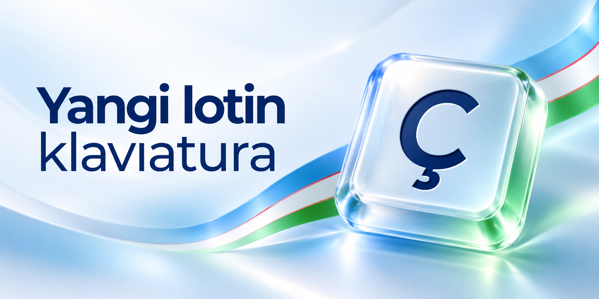

# Yangi lotin klaviatura

Windows utility for working with the updated Uzbek Latin alphabet. · Программа для работы с новым узбекским латинским алфавитом. · Yangi o‘zbek lotin alifbosida yozishga yordam beruvchi Windows dasturi.

[Download / Скачать / Yuklab olish](../../releases)

## English

Convert existing text using **sh → ş, ch → ç, o‘ → ö, g‘ → ğ**. The app also offers automatic replacement while typing when the Uzbek Latin input language is active. English and Russian interface languages are available.

Download the installer from Releases. It installs for the current user, creates a desktop shortcut and offers optional startup with Windows. Use **Uninstall.exe** in the installation folder to remove it. A portable build is available in `dist/portable`.

Requires Windows and .NET Desktop Runtime 8. This is a beta: installation and automatic input in other applications have not been fully tested. Review converted text, especially borrowed words.

## Русский

Преобразуйте готовый текст по правилам **sh → ş, ch → ç, o‘ → ö, g‘ → ğ**. Программа также предлагает автоматическую замену при наборе с активной узбекской латинской раскладкой. Интерфейс доступен на узбекском и русском языках.

Скачайте установщик в разделе Releases. Он устанавливает программу для текущего пользователя, создаёт ярлык на рабочем столе и предлагает включить автозапуск. Для удаления запустите **Uninstall.exe** в папке программы. Portable-версия находится в `dist/portable`.

Требуются Windows и .NET Desktop Runtime 8. Это бета-версия: установка и автоматический ввод в других приложениях полностью не проверены. Проверяйте преобразованный текст, особенно заимствованные слова.

## O‘zbekcha

Tayyor matndagi **sh → ş, ch → ç, o‘ → ö, g‘ → ğ** birikmalarini yangi harflarga aylantiring. O‘zbek lotin kiritish tili faol bo‘lganda, dastur yozish davomida avtomatik almashtirishni ham taklif qiladi. Interfeys o‘zbek va rus tillarida.

O‘rnatuvchini Releases bo‘limidan yuklab oling. Dastur joriy foydalanuvchi uchun o‘rnatiladi, ish stolida yorliq yaratiladi va Windows bilan avtomatik ishga tushirish imkoniyati taklif qilinadi. O‘chirish uchun dastur papkasidagi **Uninstall.exe** faylini ishga tushiring. Portable versiya `dist/portable` papkasida.

Windows va .NET Desktop Runtime 8 talab qilinadi. Bu beta-versiya: o‘rnatish va boshqa dasturlarda avtomatik kiritish to‘liq sinovdan o‘tmagan. Aylantirilgan matnni, ayniqsa o‘zlashma so‘zlarni tekshiring.

## Build

```powershell
dotnet build UzbekNewKeyboard.csproj -c Release
```

The build requires the .NET 8 SDK with Windows Desktop support.
