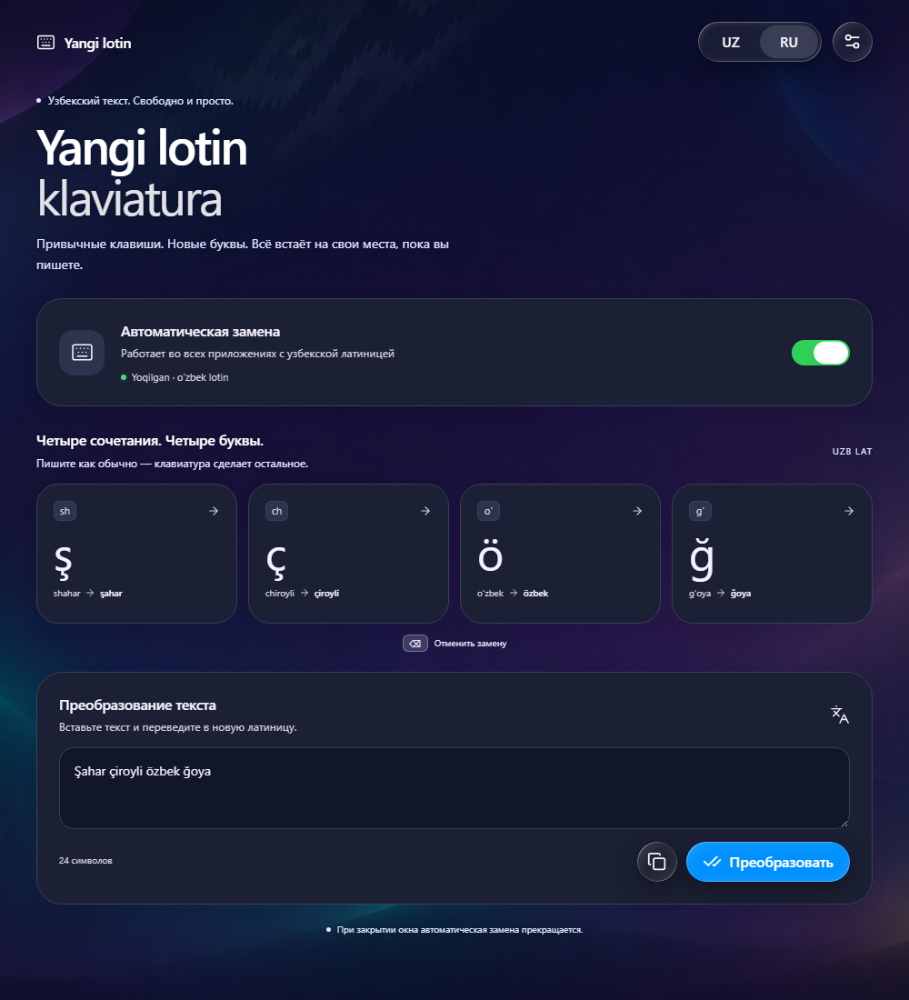

# Yangi lotin klaviatura — yangi o‘zbek alifbosi uchun Windows dasturi

**Yangi lotin klaviatura** — yangi o‘zbek alifbosida yozish uchun Windows klaviaturasi va matn konvertori. Dastur **sh → ş, ch → ç, o‘ → ö, g‘ → ğ** birikmalarini yozish paytida avtomatik almashtiradi va tayyor matnni yangi lotin harflariga o‘zgartiradi.

**Янги ўзбек алифбоси учун клавиатура:** Windows дастури янги лотин ҳарфларида ёзиш ва тайёр матнни ўзгартириш учун мўлжалланган.

**Новый узбекский алфавит на Windows:** клавиатура и преобразование текста с поддержкой букв **ş, ç, ö, ğ**. Интерфейс на узбекском и русском языках.

Joriy versiya / Текущая версия: **1.2.5**.

## Yuklab olish / Скачать

- [Windows uchun o‘rnatuvchi / Установщик](https://github.com/StokeleyDev/yangi-lotin-klaviatura/releases/latest/download/Yangi-Lotin-Setup.exe)
- [Portable ZIP — o‘rnatmasdan ishga tushirish / Без установки](https://github.com/StokeleyDev/yangi-lotin-klaviatura/releases/latest/download/Yangi-Lotin-Portable.zip)
- [SHA-256 nazorat summalari / Контрольные суммы](https://github.com/StokeleyDev/yangi-lotin-klaviatura/releases/latest/download/SHA256SUMS.txt)
- [So‘nggi versiya / Последняя версия](https://github.com/StokeleyDev/yangi-lotin-klaviatura/releases/latest) · [Barcha versiyalar / Все версии](https://github.com/StokeleyDev/yangi-lotin-klaviatura/releases)
- [O‘zgarishlar tarixi / История изменений](CHANGELOG.md)



## Yangi o‘zbek alifbosida qanday yoziladi?

Windows tizimida **O‘zbek (lotin)** kiritish tilini tanlang va dasturdagi avtomatik almashtirishni yoqing. Odatiy harf birikmalarini tering; dastur ularni quyidagicha o‘zgartiradi:

| Birikma | Natija | Misol |
| --- | --- | --- |
| sh | ş | shahar → şahar |
| ch | ç | chiroyli → çiroyli |
| o‘ yoki o' | ö | o‘zbek → özbek |
| g‘ yoki g' | ğ | g‘oya → ğoya |

Tayyor matn uchun dasturdagi matn maydoniga yozing yoki matnni joylang va **O‘zgartirish** tugmasini bosing. Dastur kirill yozuvini to‘liq lotinga o‘girish uchun emas, yuqoridagi lotin harf birikmalarini almashtirish uchun mo‘ljallangan.

### Yangi lotin klaviatura qaysi Windows tizimida ishlaydi?

Windows x64, **.NET Desktop Runtime 8** va **Microsoft Edge WebView2 Runtime** talab qilinadi. O‘rnatish uchun yuqoridagi o‘rnatuvchini yuklab oling yoki portable ZIP arxivini to‘liq oching.

## Новое в 1.2.5

- Пауза по Ctrl+Alt+Pause и список приложений-исключений в настройках.
- Поля паролей и окна, запущенные от администратора, пропускаются.
- При закрытии окно сворачивается в трей, замена продолжает работать.
- o‘/g‘ работают со всеми видами апострофа; Shift и CapsLock не сбрасывают набор.
- Установщик вдвое меньше; релизы собираются из исходников, с контрольными суммами SHA-256.

Полный список — в [CHANGELOG.md](CHANGELOG.md).

## Русский

Автоматическая замена **sh → ş, ch → ç, o‘ → ö, g‘ → ğ** при активной узбекской латинской раскладке Windows и преобразование готового текста. Интерфейс на узбекском и русском. Большие панели и карточки однотонные; Liquid Glass сохранён на кнопках, переключателях и окне настроек. Светлая и тёмная темы используют локальные фоны с узбекскими мотивами.

Требуются **Windows x64**, **.NET Desktop Runtime 8** и **Microsoft Edge WebView2 Evergreen Runtime**. Установщик устанавливает программу для текущего пользователя, создаёт ярлык и предлагает автозапуск. Закройте программу перед обновлением. Для удаления используйте список установленных приложений Windows или Uninstall.exe в папке установки.

Portable ZIP нужно распаковать целиком: папки WebUI и runtimes должны оставаться рядом с EXE. Интернет для интерфейса не требуется. При закрытии окна программа сворачивается в трей и продолжает замену; меню значка: открыть, вкл/выкл, пауза, выход.

## O‘zbekcha

**sh → ş, ch → ç, o‘ → ö, g‘ → ğ** birikmalarini avtomatik almashtiring yoki tayyor matnni o‘zgartiring. Avtomatik almashtirish uchun Windows tizimida o‘zbek lotin kiritish tilini tanlang. Interfeys o‘zbek va rus tillarida. Yorug‘ va qorong‘i mavzular mavjud.

Windows x64, .NET Desktop Runtime 8 va Microsoft Edge WebView2 Runtime kerak. Yangilashdan oldin dasturni yoping. Portable ZIP arxivini to‘liq oching; WebUI va runtimes papkalarini EXE yonida saqlang. Oyna yopilganda dastur trayda ishlashda davom etadi; chiqish tray menyusida.

## English

Automatic replacement while typing with the Uzbek Latin Windows input language, plus native conversion of existing text. Uzbek/Russian interface. React and the actual @zakisheriff/liquid-glass library are hosted locally in WebView2; the keyboard engine remains C#.

Requires Windows x64, .NET 8 Desktop Runtime and Microsoft Edge WebView2 Evergreen Runtime. The installer supports a per-user installation, desktop shortcut, optional startup and uninstall registration. Close the app before updating. Extract the entire portable ZIP before running it.

## Administrator oynalari / Окна администратора

**O‘zbekcha.** Windows oddiy dasturga administrator huquqi bilan ishlayotgan oynalarga (masalan, administrator sifatida ochilgan PowerShell yoki Vazifalar dispetcheri) klaviatura bosishlarini yuborishga ruxsat bermaydi. Shuning uchun bunday oynada dastur hech narsani almashtirmaydi va holat qatorida buni ko‘rsatadi. Agar shu oynalarda ham almashtirish kerak bo‘lsa, Yangi lotin klaviaturani ham administrator sifatida ishga tushiring.

**Русский.** Windows не позволяет обычной программе отправлять нажатия в окна, запущенные от имени администратора (например, PowerShell от администратора или Диспетчер задач). Поэтому в таких окнах программа ничего не заменяет и сообщает об этом в строке состояния. Если замена нужна и там, запустите Yangi lotin klaviatura тоже от имени администратора.

**English.** Windows blocks a normal process from injecting input into elevated windows (UIPI). The app detects elevated foreground windows, leaves input untouched there and says so in the status line. Run the app elevated if you need replacement in elevated windows.

## Konsollar / Консоли

**O‘zbekcha.** Klassik konsol (`ConsoleWindowClass`) va Windows Terminal (`CASCADIA_HOSTING_WINDOW_CLASS`) oynalarida kiritish tili fokusdagi oyna orqali aniqlanadi. Ba’zi Windows versiyalarida konsol joriy tilni noto‘g‘ri bildirishi mumkin: bunda almashtirish ishlamaydi yoki holat qatorida “Win + Space” maslahati chiqadi. Bunday holda tilni konsolda qayta almashtiring yoki konsolni istisnolar ro‘yxatiga qo‘shing.

**Русский.** В классической консоли (`ConsoleWindowClass`) и Windows Terminal (`CASCADIA_HOSTING_WINDOW_CLASS`) раскладка определяется по окну с фокусом (GetGUIThreadInfo), а не по потоку окна верхнего уровня. На некоторых версиях Windows консоль всё равно сообщает раскладку неверно: тогда замена в ней не срабатывает или в строке состояния появляется подсказка «Win + Пробел». В этом случае переключите язык ещё раз внутри консоли или добавьте её exe (`conhost.exe`, `windowsterminal.exe`) в стоп-лист.

**English.** For console hosts the input layout is read from the focus window via GetGUIThreadInfo. Some Windows builds still report a stale layout for consoles; replacement may then not trigger there.

## Kursor va sichqoncha / Курсор и мышь

**O‘zbekcha.** Yarim terilgan birikma (masalan, `s`) kursor boshqa joyga ko‘chirilganda bekor qilinadi: navigatsiya tugmalari (strelkalar, Home, End, PgUp/PgDn, Delete, Enter, Tab, Esc) va sichqoncha bilan bosish orqali. Sichqonchani bosish Windows’ning kursor (caret) hodisalari orqali aniqlanadi. Ba’zi ilovalar (ayrim brauzerlar, Electron, terminal va o‘yinlar) bu hodisalarni yubormaydi — ularda maydon ichida bosgandan keyin `s` + `h` baribir `ş` bo‘lishi mumkin. Bunday holda Backspace almashtirishni bekor qiladi.

**Русский.** Недописанная пара (например, `s`) сбрасывается, если курсор переместили: навигационными клавишами (стрелки, Home, End, PgUp/PgDn, Delete, Enter, Tab, Esc) или щелчком мыши. Щелчок определяется по событиям каретки Windows (EVENT_OBJECT_LOCATIONCHANGE для OBJID_CARET), глобальный хук мыши не используется. Некоторые приложения (часть браузеров, Electron-приложения, терминалы, игры) таких событий не отправляют — в них после щелчка внутри того же поля `s` + `h` всё ещё может дать `ş`. Backspace сразу после замены отменяет её.

**English.** A pending pair is reset by navigation keys and by caret moves not caused by typing (WinEvent caret location changes). Apps that do not report caret events may still combine a pair across a mouse click inside the same field.

## Screenshots

[Light theme](assets/interface-light.png) · [Dark theme](assets/interface-dark.png)

## Build

Install Node.js 18+ and .NET SDK 8 with Windows Desktop support. Close dev/preview servers, then run:

```powershell
./build-release.ps1
```

This builds the React UI, native host, uninstaller, embedded installer payload and both distributions under dist/. See [build details and verification limits](GLASS-BUILD.md).

Runtime downloads: [.NET Desktop Runtime](https://dotnet.microsoft.com/download/dotnet/8.0) · [WebView2](https://developer.microsoft.com/microsoft-edge/webview2/).

Release builds and headless UI checks pass. The production page and bridge were also checked in an invisible real WebView2 host. Desktop installation and global input in other applications have not been fully tested. Review converted text, especially borrowed words.
